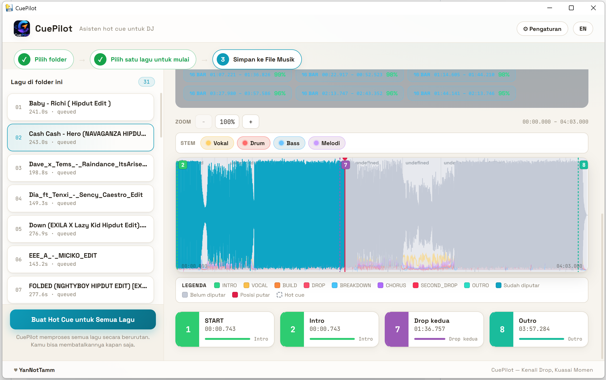
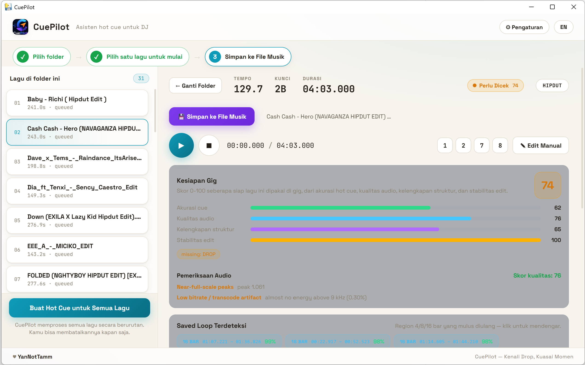
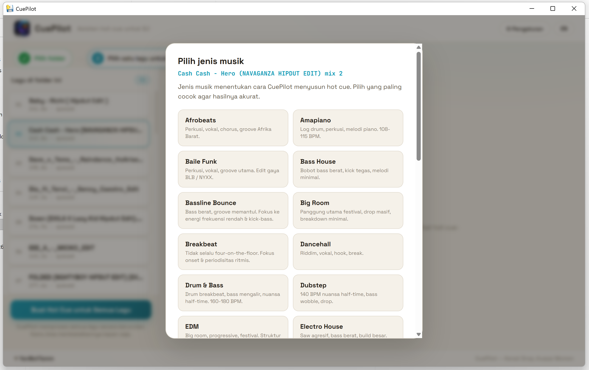
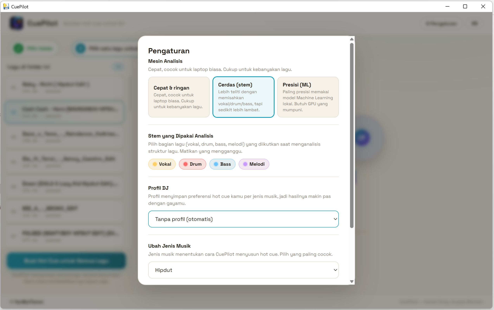
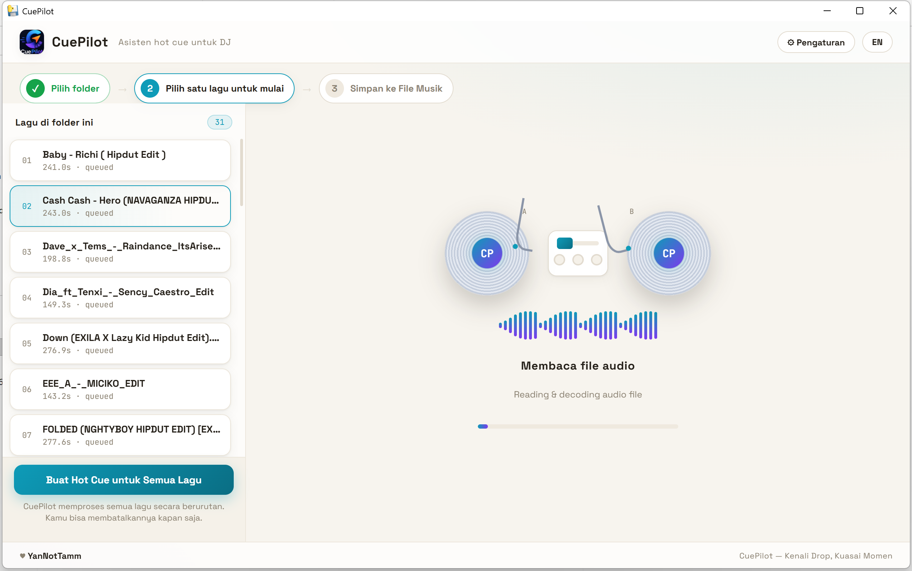

# CuePilot

<p align="center">
  
</p>

<p align="center">
  <strong>Intelligent Hot Cue & Beatgrid Generator for Serato and Rekordbox</strong><br>
  <em>Local-first, genre-aware audio intelligence engine for modern DJs.</em>
</p>

---

## Overview

**CuePilot** automates music preparation for DJs. It analyzes audio files locally, detects tempo and beatgrids, segments musical structures (intro, verse, build, drop, breakdown, chorus, outro), and generates downbeat-aligned hot cues tailored to the track's musical genre.

Audio analysis is **local-first**: your audio is processed on your machine. The optional LLM semantic layer is also local-first by default; cloud mode is explicit opt-in only (see CHANGELOG for the current behaviour).

### Key Capabilities

- **Genre-Routed Cue Placement**: Instead of a generic one-size-fits-all approach, CuePilot routes tracks through genre-aware detection strategies covering 31 genre profiles (House, Tech House, Techno, Hip-Hop, Drum & Bass, Baile Funk, Indobounce, Afrobeats, and more). The profile is **user-selected and applied as a prior — CuePilot has no genre detector**, so reports never claim a detected genre.
- **Phrase & Downbeat Precision**: Beatgrid detection (assumed 4/4 meter, global tempo — no meter detection or variable-tempo tracking yet), bar calculations, and musical phrase alignment (8/16/32-bar phrasing).
- **Stem Intelligence Engine (SIE)**: 4-channel stem sensing (vocal, bass, drums, other). With a real ONNX model it uses ML separation; **without a model it falls back to a DSP filter approximation, labelled `dsp-fallback` in reports, with reduced confidence — it is not ML separation**.
- **DJ Library Integration**:
  - **Serato DJ Pro — honest scope: Serato hot cues are NOT yet supported.** CuePilot for Serato writes BPM/key + the `CUEPILOT_CUES` tag on the audio file and exports `.cueplan.json`. The Serato Markers / DatabaseV2 format is not written and not guessed. Written tags are backed up before apply and can be rolled back; library backups are not auto-deleted after a successful apply. BPM ≤ 0 and blank keys are never written over good tags.
  - **Pioneer Rekordbox**: Direct SQLite sync into Rekordbox's `master.db` with backup, verify, and rollback. Apply is **idempotent per slot** (delete + insert per `ContentID` + `CueNumber` in one transaction, stable UUID per track + slot) and verified by comparing `(CueNumber, CueTiming)` as a set, not by row count. Writes are refused while Rekordbox still looks open (WAL/SHM files present or the database locked). **Close Rekordbox before applying, and always verify cues in Rekordbox before a gig.**
- **Desktop Application & CLI**: Includes both an interactive desktop application with interactive waveform scrubbing and a high-performance CLI for batch-processing music libraries.
- **Gig Readiness & Audio QC**: Detects audio clipping, dynamic range anomalies, corrupt headers, and provides a gig readiness score for every track.

---

## Screenshots

### Interactive Stem Waveform & Cue Points
Visualize multi-band stems (Vocal, Drum, Bass, Melody) alongside downbeat-aligned cue markers and timing cards.

<p align="center">
  
</p>

### Track Analysis & Gig Readiness
Detailed audio diagnostics including BPM, Camelot key, true peaks, dynamic range, automated loop detection, and gig readiness scoring.

<p align="center">
  
</p>

### Workflow & Configuration

| Genre Routing Profile | Multi-Engine Settings | Real-Time Processing |
| :---: | :---: | :---: |
|  |  |  |
| *30+ genre routing profiles* | *DSP vs Stem Intelligence Engine* | *Live decoding & turntable progress* |

---

## Pipeline

```text
Audio File (MP3, WAV, AIFF, FLAC, OGG)
                │
                ▼
      ┌───────────────────┐
      │  Audio Analyzer   │  (DSP Feature Extraction & Key Detection)
      └─────────┬─────────┘
                │
                ▼
      ┌───────────────────┐
      │ Beatgrid Engine   │  (BPM, Downbeats, Bars, Phrasing)
      └─────────┬─────────┘
                │
                ▼
      ┌───────────────────┐
      │ Structure Router  │  (Intro, Verse, Build, Drop, Breakdown, Outro)
      └─────────┬─────────┘
                │
                ▼
      ┌───────────────────┐
      │   Cue Generator   │  (DJ Slot Mapping & Downbeat Scoring)
      └─────────┬─────────┘
                │
        ┌───────┴───────┐
        ▼               ▼
 ┌─────────────┐ ┌─────────────┐
 │ Serato Tags │ │  Rekordbox  │
 │ & CuePlan   │ │  SQLite DB  │
 └─────────────┘ └─────────────┘
```

---

## Download

Pre-compiled standalone binaries for Windows are available on GitHub Releases. No Python environment or build setup required:

<p align="center">
  <a href="https://github.com/YanNotTamm/CuePilot/releases/tag/BETA">
    
  </a>
</p>

<p align="center">
  <a href="https://github.com/YanNotTamm/CuePilot/releases/tag/BETA">
    <strong>Download CuePilot v0.1.0 (Beta) for Windows (x64)</strong>
  </a>
</p>

---

## Installation

### Prerequisites

- Python 3.11 or higher
- FFmpeg (recommended for decoding a wide range of audio formats)

### Setup

```bash
# Clone the repository
git clone https://github.com/YanNotTamm/CuePilot.git
cd CuePilot

# Create and activate virtual environment
python -m venv .venv
# On Windows:
.venv\Scripts\activate
# On macOS / Linux:
source .venv/bin/activate

# Install dependencies and editable package
pip install -e .
# Optional extras: desktop UI (FastAPI, uvicorn, pywebview) and ONNX stem separation
pip install -e ".[desktop]"
pip install -e ".[onnx]"
```

---

## Usage

### Command Line Interface (CLI)

```bash
# Scan a directory recursively and verify file integrity
cuepilot scan "D:\Music\DJ Library"

# Analyze a single track with a specific genre profile
cuepilot analyze "D:\Music\track.mp3" --profile tech-house

# Batch-generate cue plans for an entire folder
cuepilot cues "D:\Music\EDM" --profile edm --out ./cues

# Create and run a resumable background batch job
cuepilot batch create "D:\Music\Setlist" --profile house
cuepilot batch run <job-id>
cuepilot batch status <job-id>
# Without --out, cueplans are exported to the job directory's cueplans/ folder.
# DONE tracks are skipped, failed tracks are retried up to --retries, and
# skipped tracks are reported with their reason. The legacy form
# `cuepilot batch <folder>` still works.

# Export and validate a CuePlan against the canonical schema
cuepilot export ./cues/track.cueplan.json

# Discover local Serato or Rekordbox library installations
cuepilot serato discover
cuepilot rekordbox discover
```

### Desktop UI

CuePilot provides a desktop interface featuring real-time waveform visualization, cue point editing, and library management:

```bash
# Build the web UI first (dist/ is not committed to the repo)
scripts/build_web.sh   # requires node + npm
# Launch the desktop app
python -m apps.desktop.entry
```

---

## Repository Layout

```text
CuePilot/
├── core/
│   ├── analyzer/        # Modular DSP analysis engine, Librosa & key detection
│   ├── beatgrid/        # BPM, beat, downbeat, bar, and phrase detection
│   ├── structure/       # Section segmentation and classification
│   ├── scoring/         # CueScore formula and downbeat alignment weighting
│   ├── profiles/        # Genre-specific cueing and phrasing profiles
│   ├── cues/            # DJ slot mapping and cue generator
│   ├── stems/           # Stem Intelligence Engine (vocal/bass/drums energy)
│   ├── integrations/    # Serato and Rekordbox library sync adapters
│   ├── quality/         # Audio QC and Gig Readiness scoring
│   ├── compatibility/   # Harmonic mixing & transition advisor
│   ├── crates/          # Smart crate auto-organization
│   ├── learn/           # Personalization and correction learning store
│   ├── scanner.py       # Audio folder scanner and deduplication
│   ├── pipeline.py      # End-to-end analysis orchestration
│   └── export.py        # Canonical JSON export and schema validation
├── apps/
│   └── desktop/         # Desktop application (FastAPI sidecar + Web UI)
├── schemas/             # JSON schemas for canonical CuePlan data
├── cli/                 # Command-line interface
├── tests/               # Unit, integration, and synthetic audio test suite
├── benchmarks/          # DSP benchmark harness and accuracy metrics
└── models/              # Pretrained models directory for stem separation
```

---

## Benchmarks

CuePilot includes an offline benchmark suite (`benchmarks.benchmark`) to evaluate DSP accuracy against synthetic ground truth tracks:

```bash
python -m benchmarks.benchmark
```

> **Previous cue-accuracy claims are withdrawn.** The table below is the
> last measured data in `benchmarks/results.json` (synthetic tracks only).
> The `edm_140` failure is section classification + boundary drift at
> 140 BPM, not the beatgrid (beat/downbeat F1 1.00). New figures will only
> be stated after the benchmark is re-run in an environment with librosa.
> Do not use these synthetic figures as a promise for real tracks.

| Benchmark Case | Detected BPM | Beat F1 | Downbeat F1 | Boundary F1 | Cue Error |
|---|---|---|---|---|---|
| `edm_128` | 128.2 | 1.00 | 1.00 | 1.00 | 0.647s |
| `edm_140` | 140.1 | 1.00 | 1.00 | 0.667 | 7.434s |
| `techno_132` | 132.2 | 1.00 | 1.00 | 1.00 | 0.019s |
| `hiphop_95` | 95.0 | 1.00 | 1.00 | 1.00 | 0.019s |

---

## License

This project is licensed under the MIT License - see the LICENSE file for details.
